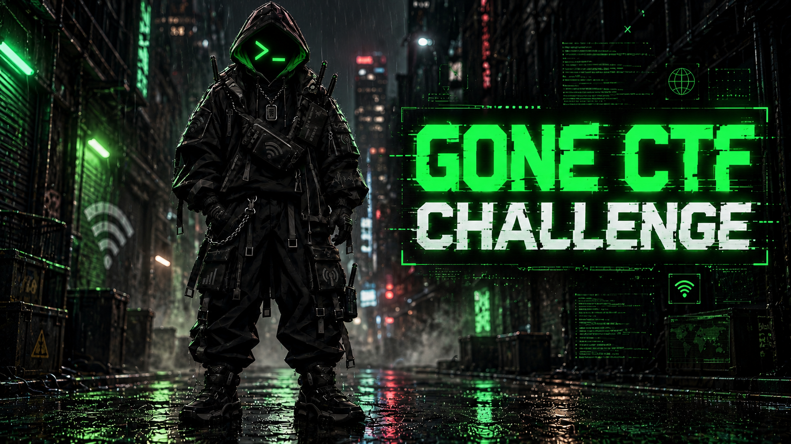

  

<h1 align="center">GONE</h1>

  <strong>One disappearance. One video. One challenge.</strong>

  
  

---

## The challenge

Your challenge begins with a single video.

**Your objective: find the final flag.**

 

  

  <a href="https://drive.google.com/file/d/15LbhyDJkYqikZ-ZnWDWb94kax2g2uvv7/view?usp=drive_link">Open the challenge video in Google Drive →</a>

 

---

  <strong>Created by <a href="https://github.com/DensenDeluxe">DensenDeluxe</a></strong>

